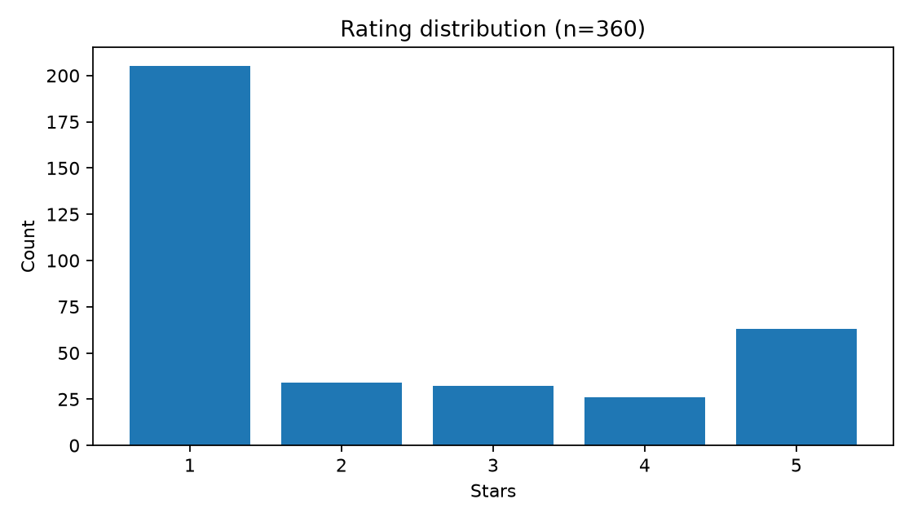
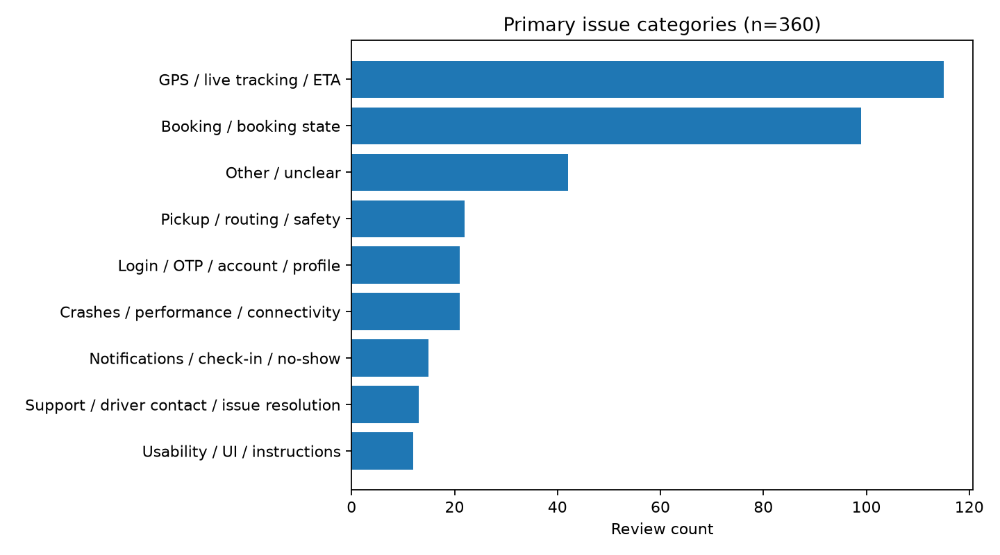

# MoveInSync Play Store Review Analysis

<p align="center">
  
</p>

A review-driven case study to identify user pain points and prioritize product and engineering improvements for MoveInSync.


## Key Findings

- **360 reviews** analyzed
- **2.19/5** average rating in this sample
- **66.4%** of reviews are rated 1–2 stars
- Most common themes: **GPS/live tracking/ETA** and **booking issues**

> The average rating reflects only the supplied sample—not MoveInSync's current overall Play Store rating.

## Top Issues

<p align="center">
  
</p>


## Recommended Priorities

1. **Improve tracking and ETA reliability** — validate location freshness, permissions, and network conditions.
2. **Fix booking-state confusion** — audit booking, cancellation, assignment, and pickup flows.
3. **Investigate pickup and safety friction** — check pickup accuracy and escalation paths.
4. **Monitor by app version and device** — connect review themes to crashes, support tickets, and trip outcomes.

These are investigation priorities; internal telemetry is needed to confirm root causes.

## Method

The Python script cleans the CSV, validates ratings and dates, checks duplicate IDs, assigns one primary category using keyword rules, and generates summary tables and charts. Categories are rule-based and not human-validated.

## Files

- [`Analysis report (PDF)`](MoveInSync_FDE_Review_Analysis_Report.pdf)
- [`Cleaned reviews (CSV)`](moveinsync_cleaned_reviews.csv)
- [`Analysis script`](analyze_moveinsync_reviews.py)
- [`Methodology and tools note`](research_and_tools_note.md)
- [`Issue frequency (CSV)`](issue_frequency.csv)
- [`Summary metrics (CSV)`](summary_metrics.csv)

## Run Locally

```bash
python -m pip install pandas numpy matplotlib
python analyze_moveinsync_reviews.py "google_play_reviews_1791741001758(1).csv" --outdir moveinsync_analysis
```

**Author:** [Anshuman Hota](https://github.com/hotaanshuman4)  
*MoveInSync Forward Deployed Engineer case-study submission.*
